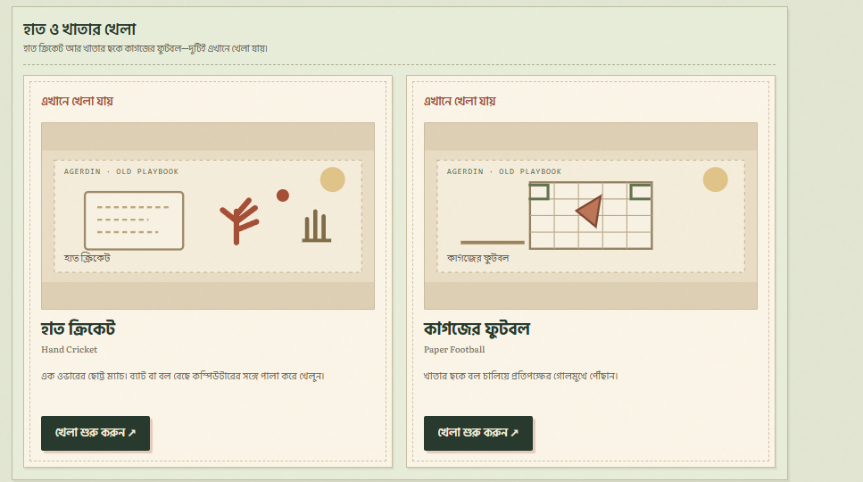
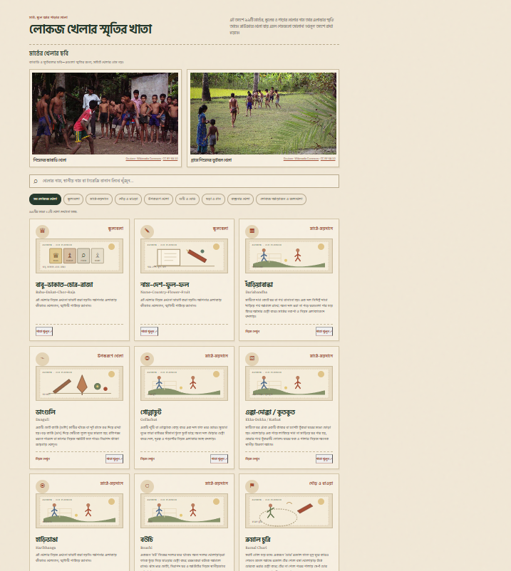

# Agerdin — আগেরদিন

**Public preview:** [https://agerdin-bangladesh-games.mahfuz085-cuet.chatgpt.site/](https://agerdin-bangladesh-games.mahfuz085-cuet.chatgpt.site/)  
**Vercel domain:** [https://agerdin.vercel.app/](https://agerdin.vercel.app/) (deployment is managed separately)

Agerdin is a bilingual collection of Bangladeshi childhood games, neighborhood memories, and small browser games, presented like a well-kept old notebook.

## Screenshots

| Games you can play here | Folk-game archive |
| --- | --- |
|  |  |

## Games

### Play in Agerdin

**Folk and paper games:** Kata-Kuti, Notebook Cricket, Paper Football, Ludo, Bantumi, Five Stones, Hand Cricket, Pen Fight, and Odd or Even.

**Computer-shop arcade:** Road Run, Snake, Brick Breaker, Para to the Moon, Tiffin-Break Bounce, Token Fight, Para Watch, Penalty Shootout, Neighborhood Delivery, Carrom, and Table Tennis.

The archive also describes games that are not playable in the browser. Those entries are presented as memories and references, not as playable cards. Its 99 folk-game cards use distinct credited photographs, with local-rule descriptions where documented and explicit notes where reliable rule details are scarce. A small number of classic commercial-game pages link outward; Agerdin does not host those games.

## Controls

- Folk and paper games use on-screen choices and buttons; each game explains its rules before a round.
- Snake: arrows or WASD; on-screen direction pad on touch screens.
- Brick Breaker: Left/Right or A/D; on-screen controls, pause, and replay.
- Para to the Moon: arrows or WASD to move, Space to fire, K to use a shield; touch controls are included.
- Road Run: Left/Right or A/D, or the on-screen steering buttons.
- Other arcade games show their controls inside the game panel.

## Project layout

- `dist/index.html` — page shell, metadata, and separate hash-routed sections for Home, Play, Computer Shop, Archive, and About.
- `dist/css/style.css` — responsive charcoal-and-sand theme, clear contrast, and section transitions.
- `dist/app.js` — stable self-contained UI and game runtime. It renders the game and archive catalogs in one pass, including the 99 credited real-photo archive cards.
- `dist/data/` and `dist/js/` — retained catalog, translations, and modular game sources for future refactoring; they are not needed for the active startup path.
- `dist/assets/` — shared logo, PWA icons, and locally stored fonts with license notice.
- `dist/manifest.webmanifest` and `dist/service-worker.js` — install metadata and a small offline cache for the active app shell.

The current release uses one renderer so a failed module or data request cannot leave the game and archive sections empty or swap renderers after the page appears. The site still has separate navigation views; the runtime file does not combine those views into one screen.

This is a no-build static site. Deploy the contents of `dist/` as the project root on Vercel or Netlify. The package includes a custom `404.html`, `robots.txt`, and `sitemap.xml`.

## Contact form setup

The memory form uses a FormSubmit alias placeholder rather than exposing the owner's mailbox. Replace `AGERDIN_FORM_SUBMIT_ALIAS` in `dist/index.html` with the alias generated and confirmed by the FormSubmit account owner before enabling submissions. Until then, the form reports that sending is unavailable.

## Font note

The exact Hind Siliguri and Literata binaries could not be fetched in this environment. To keep the page independent of Google Fonts, the current preview self-hosts Noto Sans Bengali and Noto Serif Bengali in regular and bold weights as locally stored substitutes. The Noto license is included beside those files.

See [RELEASE-NOTES.md](RELEASE-NOTES.md) for changes and [CREDITS.md](CREDITS.md) for image, font, and source notes.
